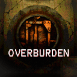
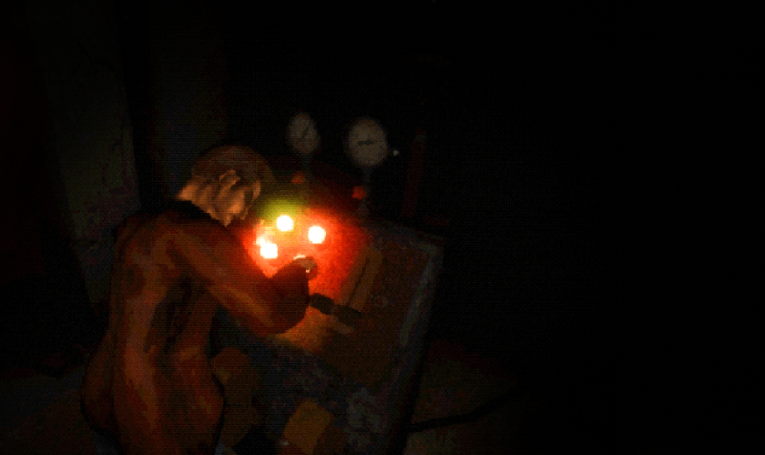

  

  

  An experimental, unofficial port of <a href="https://notsospecialgames.itch.io/overburden"><strong>Overburden</strong></a> for PlayStation Vita.

  <em>Powered by a customized <a href="https://github.com/WolffsRoom/godot4-vita">Godot 4 Vita</a> runtime, with an experimental native GXM 3D renderer.</em>

> [!IMPORTANT]
> **Work in progress!**
> There is **no public release yet**. Builds are only being tested internally on real PS Vita hardware. No game files, VPK or ready-made game_data are distributed in this repository.

## Project status

  
  
   
  
  
  

 

The full game boots and is playable on real PS Vita hardware. Rendering is a work-in-progress native GXM 3D path: lighting, shadows and the game's screen filters are not implemented yet, and **performance is not stable** (about 30 FPS in gameplay on the latest device logs).

| Component | Current state |
| :--- | :--- |
| Boot / LiveArea | Animated 960 × 544 startup and custom LiveArea working |
| Gameplay | Playable on physical hardware, from the intro to the final level |
| Controls | Native Vita mapping, right stick as camera/cursor, Select toggles 4:3 / 16:9 in menus |
| Rendering | Native GXM 3D for textured meshes, CPU skinning, distance culling and a triangle budget |
| Effects | No dynamic lighting, shadow maps, fog or screen filters yet; bounded CPU particles and contact shadows as substitutes |
| Audio | Working, mixer pinned to the fourth CPU core through CapUnlocker |
| Loading | Pressing Start still takes long; being measured and reduced |
| Performance | ~45 FPS in the main menu, ~30 FPS in gameplay; physics is the largest remaining cost |
| Public VPK / Release | **Not available yet** |

_If you enjoy my work, consider supporting the development!_

 <strong>Support this and other projects</strong>

## About the port

*Overburden* is an experimental tactile horror game by **notsospecialgames** about operating an unstable industrial drill, made in Godot. This project runs the original game's Godot content through a PlayStation Vita-specific runtime instead of recreating it in another engine.

The Vita implementation uses a customized Godot 4.x runtime with a native GXM backend. Platform-specific work includes the 3D mesh renderer, CPU skeleton deformation, controller integration, memory budgets (extended application memory and CDRAM texture limits), RGBA4444 texture uploads, boot animation, audio routing and on-device performance logging.

This is an **unofficial fan project**, not affiliated with or endorsed by notsospecialgames, Sony, or the Godot Engine project.

## Current development priorities

- Reduce the loading time after pressing Start (texture decoding and scene instancing).
- Approximate the game's darkness, lights, fog and vignette without screen-reading shaders.
- Lower the physics cost per frame and stabilize FPS.
- Keep reducing 3D pop-in and flickering caused by the triangle budget.
- Prepare a PC-to-Vita patcher so players can build game_data from their own copy, as in [Ambidextro Vita](https://github.com/WolffsRoom/Ambidextro-Vita).

See [Development status](docs/PORT_STATUS.md) for the detailed state of each area.

## Technical background

This port is built around [Godot 4 Vita](https://github.com/WolffsRoom/godot4-vita), [VitaSDK](https://vitasdk.org), a native [GXM](https://www.psdevwiki.com/vita/SceGxm) rendering path and Vita runtime integrations. It currently targets a Godot 4.8 development build adapted for the Vita.

Unlike the original PC renderer (Forward+ with SDFGI, SSAO, SSR, glow and volumetric fog), the Vita renderer only draws textured, unlit geometry for now. Screenshots and performance results should be understood as work-in-progress.

## AI Notice

AI coding assistants (Codex and Claude Code) were used for diagnostics, implementation support, project organization and technical documentation.

## Credits

- [notsospecialgames - Overburden](https://notsospecialgames.itch.io/overburden): original game, artwork, sound, and design.
- [Godot Engine](https://godotengine.org): original engine.
- [WolffsRoom / Godot 4 Vita](https://github.com/WolffsRoom/godot4-vita): experimental Vita runtime and rendering backend.
- [VitaSDK](https://vitasdk.org) and the wider PS Vita homebrew development community.

---

<em>This repository is documentation-only during development.
The original game and all of its associated intellectual property remain the property of their respective rights holders.</em>

